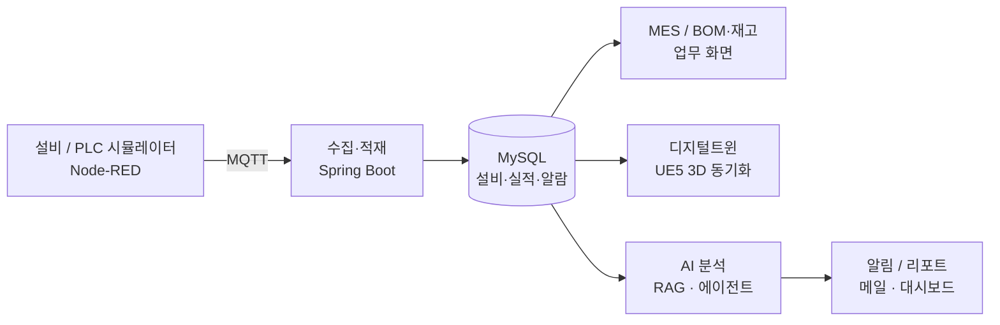

# 안녕하세요, 제조 현장 데이터를 시스템으로 잇는 백엔드 개발자 [이름]입니다 👋

> **설비 신호 → 생산 데이터 → MES/업무 시스템 → AI 판단 지원**
> 공장 데이터가 흘러가는 전 구간을 직접 만들어 본 **제조 IT / MES 백엔드** 신입 개발자입니다.

- 🏭 **도메인**: MES(작업지시·생산실적·설비·LOT 추적), BOM·재고, 설비 상태/알람, 디지털트윈
- ⚙️ **주력**: Java · Spring Boot · MySQL/MyBatis · MQTT · Node-RED
- 🤖 **AX 경험**: RAG 기반 설비 알람 원인 분석 · LLM 에이전트로 생산 데이터 조회 *(개인 프로젝트 진행 중)*
- 🎓 영남대학교 정보통신공학과 · 현대오토에버 모빌리티 SW스쿨 스마트팩토리 과정 **1,000시간 수료**
- 📜 정보처리기사 · SQLD · TOEIC Speaking IH

📫 **Contact** : your.email@example.com · [Blog/Notion 포트폴리오](https://) <!-- 실제 링크로 교체 -->

---

## 🔎 30초 요약 (면접관용)

| 프로젝트 | 한 줄 설명 | 내 역할 | 핵심 기술 |
|---|---|---|---|
| **LineMind** *(개인·진행 중, 저장소 공개 예정)* | 미니 MES + 설비 비가동 원인을 답하는 AI 에이전트 | 단독 설계·개발 | Spring Boot, MQTT/OPC UA, Docker, LLM Tool Calling |
| **[FactoryEye](https://github.com/pyosjung/BS-SCADA)** | 설비 모니터링 + RAG 알람 분석 SCADA PoC | 설비 시뮬레이션, 알람 API, RAG 메일링 | Spring Boot, MySQL, MQTT, Node-RED, RAG |
| **[자동차 차체공정 디지털트윈](https://github.com/pyosjung/Digital-Twin-Project)** | 스테이션·AGV·컨베이어·로봇 상태를 3D로 동기화 | **팀장**, 생산 시뮬레이션, DB 설계, 로봇암 BP | UE5 Blueprint, Node-RED, MySQL, MQTT |
| **[Auto BOM Inventory](https://github.com/pyosjung/auto-bom-inventory)** | 수주–BOM–자재–재고를 잇는 관리 시스템 | 자재관리 화면, 단가·재고 테이블 | Spring Boot, MyBatis, MySQL, Vue.js |
| **[4번째 프로젝트명]** <!-- 채워 넣기 --> | | | |

---

## 🧭 제가 만든 데이터 흐름

네 개의 프로젝트는 따로 떨어진 과제가 아니라, **수집 → 저장 → 업무 연결 → 시각화 → AI 판단**으로 이어지는 하나의 흐름을 구간별로 만든 것입니다.

---

## 📂 주요 프로젝트

### 1. FactoryEye — 설비 모니터링 & RAG 알람 분석 (팀 프로젝트)
**문제**: 알람이 발생해도 작업자가 매뉴얼과 과거 이력을 직접 찾아야 해서 조치가 늦어짐
**해결**: 설비 상태·알람 이력을 실시간으로 수집하고, 알람이 발생하면 과거 이력과 매뉴얼을 RAG로 검색해 **원인 후보와 조치 방법을 메일로 자동 전달**

**내가 한 일**
- Node-RED로 설비 이벤트 시뮬레이터 구현 (설비 __대, 이벤트 주기 __초) <!-- 수치 입력 -->
- 알람 조회·관리 REST API 설계 및 구현
- RAG 기반 알람 분석 + 메일링 기능 구현

**트러블슈팅**
- ❗ *(예시 형식)* 알람이 한꺼번에 몰릴 때 메일이 중복 발송됨 → 알람 코드 + 설비 ID 기준 N분 디바운싱 적용 → 중복 발송 0건 <!-- 실제 사례로 교체 -->

**결과**: 알람 발생부터 원인 안내 메일까지 평균 __초 <!-- 측정 후 입력 -->
`Spring Boot` `MySQL` `MQTT` `Node-RED` `Python` `RAG`
▶️ [시연 영상](https://) · 📄 [상세 README](https://github.com/sleeping-6eauty/BS-SCADA)

---

### 2. 자동차 차체공정 디지털트윈 (팀장 · 팀 프로젝트)
**문제**: 차체 라인의 스테이션·AGV·로봇 상태를 한 화면에서 직관적으로 파악하기 어려움
**해결**: 생산 시뮬레이션 데이터를 MQTT로 UE5와 동기화해 라인 상태를 3D로 재현

**내가 한 일**
- 팀장: 일정·역할 분배, 데이터 인터페이스 규격 정의
- Node-RED 생산 시뮬레이션, MySQL 스키마 설계, UE5 로봇암 Blueprint 구현
- *(팀원 담당: UE5–MQTT 연동)*

**트러블슈팅**: <!-- 예: 3D 동기화 지연, 상태값 불일치 등 실제 사례 1~2개 -->
`Unreal Engine 5` `Blueprint` `Node-RED` `MySQL` `MQTT`
▶️ [시연 영상](https://) · 📄 [상세 README](https://github.com/sleeping-6eauty/Digital-Twin-Project)

---

### 3. Auto BOM Inventory — 수주·BOM·재고 관리 (팀 프로젝트)
**문제**: 수주가 들어오면 필요한 자재 수량을 수작업으로 계산함
**해결**: 수주 → BOM 전개 → 자재 소요량 → 재고 차감까지 하나로 연결

**내가 한 일**: 자재관리 화면, 단가·재고 테이블 설계 및 구현
`Spring Boot` `MyBatis` `MySQL` `Vue.js`
📄 [저장소](https://github.com/sleeping-6eauty/auto-bom-inventory)

---

### 4. LineMind — 미니 MES + 비가동 원인 분석 AI 에이전트 (개인 · 진행 중)
교육 과정이 끝난 뒤 **혼자 처음부터 끝까지** 만드는 프로젝트입니다.
작업지시·생산실적·OEE·LOT 추적이 되는 미니 MES를 만들고, *"어제 2라인 OEE가 왜 떨어졌어?"* 같은 질문에 **LLM 에이전트가 MES DB를 직접 조회해 근거와 함께 답하게** 합니다.
📄 저장소 공개 예정 <!-- 저장소 만든 뒤 https://github.com/pyosjung/LineMind 링크로 교체 -->

---

## 🛠 Tech Stack

| 분야 | 기술 |
|---|---|
| Backend | Java 17, Spring Boot, JPA/MyBatis, REST API |
| DB | MySQL, SQL 튜닝 기초 (SQLD) |
| 산업 통신·연동 | MQTT, Node-RED, OPC UA *(학습 중)* |
| Frontend | Vue.js |
| Digital Twin | Unreal Engine 5 Blueprint |
| AI | Python, RAG, LLM Tool Calling |
| DevOps | Git, Docker, GitHub Actions *(LineMind에서 적용)* |

---

## 💡 일하는 원칙
1. **업무를 먼저 이해합니다.** 화면보다 "현장에서 누가, 언제, 무엇을 판단하는가"부터 정리합니다.
2. **데이터 흐름을 끝까지 설계합니다.** 수집–저장–표시–알림 중 어느 구간에서 값이 바뀌는지 추적할 수 있게 만듭니다.
3. **팀 성과와 내 기여를 구분해 기록합니다.** 위 프로젝트 설명에서도 제가 직접 한 부분만 "내가 한 일"에 적었습니다.

---

## 🎯 관심 분야
제조 IT / MES 개발 · 스마트팩토리 플랫폼 · 생산·물류 IT · **제조 AX(AI 전환)** · 디지털트윈
